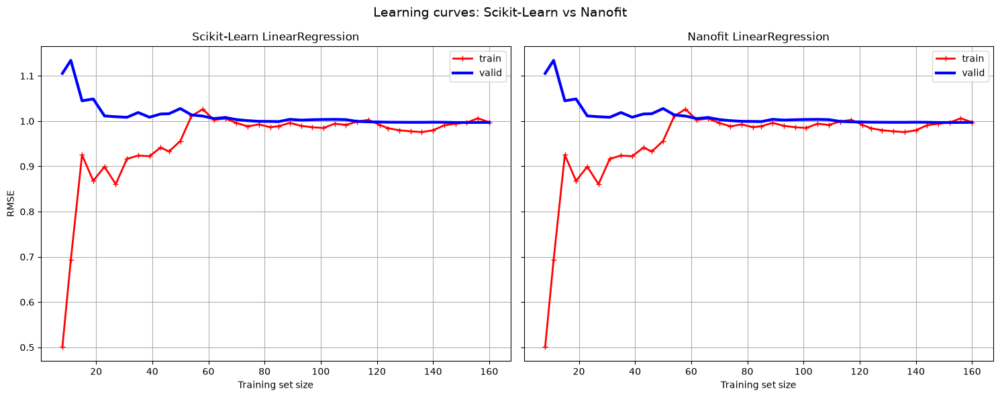
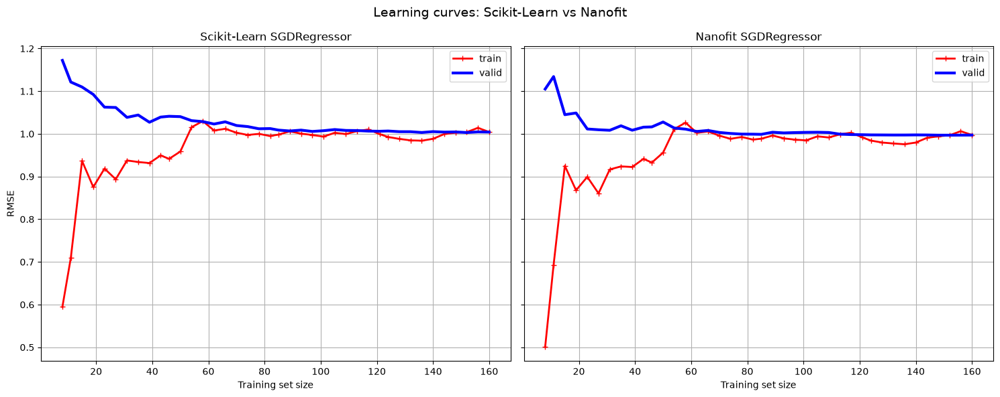

<div align="center">


# nanofit

**A lightweight, scikit-learn compatible linear regression library implemented from scratch with NumPy.**

[](https://github.com/Rickmwasofficial/nanofit.git)
[](pyproject.toml)

</div>

---

## 📌 Repository Link

- **Repository**: [https://github.com/Rickmwasofficial/nanofit.git](https://github.com/Rickmwasofficial/nanofit.git)
- **Clone via HTTPS**:
  ```bash
  git clone https://github.com/Rickmwasofficial/nanofit.git
  ```
- **Clone via SSH**:
  ```bash
  git clone git@github.com:Rickmwasofficial/nanofit.git
  ```

---

## 🚀 Overview

`nanofit` provides clean, minimalist implementations of fundamental linear regression algorithms. Built to be fully compatible with `scikit-learn`'s estimator interface (`BaseEstimator`, `RegressorMixin`), all models can seamlessly integrate into standard evaluation workflows (such as `learning_curve`, cross-validation, and pipelines).

### Implemented Models
- **`LinearRegression`**:
  - `method="normal"`: Closed-form solution using the Moore-Penrose pseudoinverse ($\theta = X^+ y$).
  - `method="grad"`: Batch Gradient Descent optimization.
- **`SGDRegressor`**: Stochastic Gradient Descent with an inverse scaling learning rate schedule ($\eta = \frac{t_1}{t + t_2}$).
- **`MBRegressor`**: Mini-Batch Gradient Descent supporting custom batch sizes and learning schedules.

---

## 📦 Installation

```bash
git clone https://github.com/Rickmwasofficial/nanofit.git
cd nanofit
pip install -e .
```

---

## 💡 Quickstart

```python
import numpy as np
from nanofit.linear_models import LinearRegression, SGDRegressor, MBRegressor

# Generate sample data
X = 2 * np.random.rand(100, 1)
y = 4 + 3 * X + np.random.randn(100, 1)

# 1. Linear Regression (Normal Equation)
lr_model = LinearRegression(method="normal")
lr_model.fit(X, y)
print("Coefficients:", lr_model.coeff_, "Intercept:", lr_model.intercept_)

# 2. Stochastic Gradient Descent Regressor
sgd_model = SGDRegressor(n_epochs=1000, random_state=42)
sgd_model.fit(X, y)

# 3. Mini-Batch Regressor
mb_model = MBRegressor(batch_size=20, n_epochs=500, random_state=42)
mb_model.fit(X, y)

# Predict & Score (MSE)
preds = lr_model.predict(X)
mse_score = lr_model.score(X, y)
```

---

## 📊 Learning Curves: Scikit-Learn vs. Nanofit

Evaluated on synthetic datasets using 5-fold cross-validation with Root Mean Squared Error (RMSE) scoring, as demonstrated in [`examples/compare.ipynb`](examples/compare.ipynb):

### 1. Linear Regression Comparison
The normal equation implementation in `nanofit` achieves parameter parity and matching learning curves with Scikit-Learn's `LinearRegression`:



### 2. SGD Regressor Comparison
`nanofit`'s `SGDRegressor` exhibits rapid convergence and competitive validation RMSE against Scikit-Learn's `SGDRegressor`:


